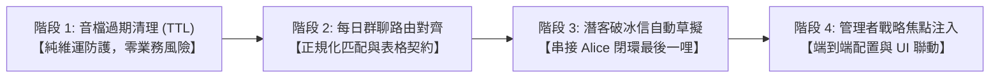

# Phase 5.12.1: 星環討論體系全鏈路深度優化與商業閉環硬化 (Star-Topology Optimization & Pipeline Hardening)

## 📌 背景與動機 (Context & Motivation)

在歷經 Phase 5.11.24 ~ 5.11.26 解決 Telegram 長訊息切片、Alice 潛客痛點評分、Bob 內容自動發布與日報流水線解耦後，系統健康度與測試覆蓋率達到 783 項全綠通過的新高度。

然而，在對資料庫實體（Supabase Storage、`archon_workflow_flows`、`archon_tasks`）與代碼進行深度物理審計時，確認星環討論模組仍存在 **4 項真實具體的架構斷層與優化空間**：

1. **Storage 音檔未設過期清理機制 (TTS Podcast Storage Quota Leak)**：
   - [report_enrichment_service.py](file:///Users/vincenta/GoogleKwok022/Archon/python/src/server/services/report_enrichment_service.py) 生成週報/月報 Podcast 時，將單檔 2~5 MB 的 `.wav` 音檔上傳至 `archon_documents` bucket，僅設定簽名 URL 7 天過期。
   - **實體對帳確認**：儲存庫中目前殘留自 2026/07/20 至今的 14 份歷史音檔，物理檔案**從未被刪除**，無任何 TTL 清理排程，長年運行將撐爆 Supabase 免費層 1GB 上限。

2. **Daily Summary 路由字串不匹配與單節點退化 (Single SummaryNode Degradation & Contract Conflict)**：
   - 在 [agent_service.py](file:///Users/vincenta/GoogleKwok022/Archon/python/src/server/services/agent_service.py) 中傳入 `task_type = "daily_executive_summary"`；但資料庫 `archon_workflow_flows` 中存為 `"Daily Executive Summary"`。
   - 大小寫不一致導致 [nodes.py](file:///Users/vincenta/GoogleKwok022/Archon/python/src/agents/workflow/nodes.py) 查詢 100% 落空，靜默回退至 `General` 流程，使 Supervisor Charlie 遇日報任務時僅單點調用 `SummaryNode` 並結束（`step_count` 永遠固定為 2），未真正調度 Alice、Bob 與 DevBot。
   - 上游 [pm_prompts.py](file:///Users/vincenta/GoogleKwok022/Archon/python/src/server/prompts/pm_prompts.py) 強制要求「*Markdown 表格與計算指標公式*」，但下游 `WORKFLOW_WORKER_SUMMARY` 卻被硬編碼為「*You summarize text into bullet points*」，下游輸出直接推翻上游契約。

3. **高意向合格潛客「最後一哩路」未自動閉環 (Cold Outreach Draft Gap)**：
   - Phase 5.11.25 成功將合格名單推送至 Telegram，但 [leads_patrol.py](file:///Users/vincenta/GoogleKwok022/Archon/python/src/server/services/scheduler/jobs/leads_patrol.py) 僅止於提示「請點選職缺連結破冰」。
   - 系統未自動調度 Agent 為目標企業職缺痛點生成客製化「1-on-1 痛點破冰信草稿 (Cold Outreach Draft)」，亦未在 `archon_tasks` 建立跟進工單，導致商業漏斗在通報後依賴人工手寫信，轉化效率中斷。

4. **每週/每月高階戰略討論缺乏「管理者假設注入」介面 (Management Steering Focus Gap)**：
   - 週報與月報是 100% 由後端 Cron 靜態觸發執行 `_execute_map_reduce_summary`，僅單向被動統計歷史指標。
   - 缺乏管理者在週會前輸入「本週重點驗證假設（如：驗證新版 RAG 破冰回覆率）」的管道，導致 AI 代理人在 Map 階段無法針對具體經營方針進行交叉驗證。

---

## 🎯 核心實作目標與四階段推進順序 (Step-by-Step Implementation)

遵循「防改 A 壞 B」與「高內聚低耦合」原則，本 Phase 分為四個循序漸進的實施階段：

---

### 階段 1：Supabase Storage 音檔過期清理機制 (TTL Cleanup)

* **目標**：在不影響任何業務通報的前提下，自動清除建立超過 14 天的歷史 Podcast 音檔，釋放儲存空間。
* **修改檔案**：
  1. `python/src/server/schemas/settings.py`：
     - 在 `PruningConfig` 新增 `storage_podcast_ttl_days: int = Field(default=14, alias="STORAGE_PODCAST_TTL_DAYS")`。
  2. `python/src/server/services/report_enrichment_service.py`：
     - 新增靜態方法 `prune_expired_podcast_audio(ttl_days: int) -> int`：
       - 調用 `supabase.storage.from_("archon_documents").list()`，篩選出符合前綴 `podcast_` 且副檔名為 `.wav` 的檔案。
       - 比對檔案 `created_at`，若超過 `ttl_days`，呼叫 `supabase.storage.from_("archon_documents").remove([name])` 物理移除。
       - 回傳清理檔案總數並記錄審計日誌至 `archon_logs`。
  3. `python/src/server/services/scheduler/jobs/patrol_infra.py`：
     - 在 `run_tiered_pruning()` 中整合呼叫 `prune_expired_podcast_audio()`，使音檔與日誌、潛客、向量共同接受分層修剪。
* **防壞防線**：
  - 嚴格限定檔案前綴為 `podcast_` 且副檔名為 `.wav`，絕對不可觸碰使用者的其他上傳文件或圖檔。

---

### 階段 2：每日星環群聊路由正規化對齊與表格契約落地

* **目標**：解決大小寫不匹配導致的退化問題，並使輸出遵循「Markdown 結構化表格與名詞定義」規範。
* **修改檔案**：
  1. `python/src/agents/workflow/nodes.py`：
     - 在 `SupervisorNode` 查詢 `archon_workflow_flows` 時，導入不區分大小寫與底線的正規化匹配（例如比對 `f["workflow_type"].lower().replace(" ", "_") == task_type.lower().replace(" ", "_")`），確保 100% 命中 DB 流轉規則。
     - 若命中 `Daily Executive Summary`，確保 `node_routing` 正確支援 `marketbot`、`devbot` 與 `summary`。
  2. `python/src/server/prompts/pm_prompts.py`：
     - 更新 `WORKFLOW_WORKER_SUMMARY`：廢除「*You summarize text into bullet points*」的硬限制。
     - 改為要求：「*You summarize the team discussion into professional Executive Summary format with Markdown tables and metric definitions, following the user's structural instructions.*」。
* **防壞防線**：
  - 保留對歷史任務 Title 的相容性 Fallback。
  - 維持 `step_count` 電路斷路器（Circuit Breaker），確保群聊在 3~5 步內穩定收斂收尾，杜絕無限循環。

---

### 階段 3：合格潛客客製化 1-on-1 痛點破冰信自動草擬

* **目標**：當篩選出高意向合格名單（`status: qualified`）時，自動生成針對該企業具體技術痛點的破冰信草稿，直接附在 Telegram 通報中供業務一鍵複製發送。
* **修改檔案**：
  1. `python/src/server/prompts/pm_prompts.py`：
     - 新增 `QUALIFIED_LEAD_OUTREACH_PROMPT`：指導 AI 針對目標企業名稱、刊登職缺、技術棧與潛在痛點，撰寫 150~250 字之高精準 1-on-1 破冰信模板。
  2. `python/src/server/services/scheduler/jobs/leads_patrol.py`：
     - 在組裝合格名單戰鬥簡報時，調用輕量模型（`gemini-3.5-flash-lite`）為 Top 1~2 筆最高分合格潛客生成破冰信草稿。
     - 整合至 Telegram 推播簡報中的 `✉️ 【客製化痛點破冰信草稿 (一鍵複製)】` 區塊。
* **防壞防線**：
  - 嚴格限制單次排程最多僅為 **Top 2 筆** 潛客生成草稿，杜絕超出 Google Free Tier 25 萬 TPM 配額限制引發 429 死亡循環。

---

### 階段 4：每週/每月高階戰略討論之「管理者目標對齊」輸入介面

* **目標**：允許管理層在後台輸入次週/次月的重點經營假設，AI 在 Map-Reduce 階段動態載入該焦點並進行交叉驗證。
* **修改檔案**：
  1. `python/src/server/schemas/settings.py`：
     - 在 `SchedulerConfig` 或獨立 `StrategicConfig` 新增 `management_steering_focus: str | None = Field(default=None, alias="MANAGEMENT_STEERING_FOCUS")`。
  2. `python/src/server/services/report_service.py`：
     - 在 `_execute_map_reduce_summary` 與 `gather_report_context` 中，讀取 `management_steering_focus`。
     - 若有設定，將其作為 `【管理者戰略關注焦點 (Management Strategic Focus)】` 注入至 Map-Reduce 各代理人的 Prompt 上下文中。
* **防壞防線**：
  - 此設定欄位為 `Optional[str]`（選填），若管理者未輸入任何內容，系統 100% 回退至既有的客觀數據統計模式，不影響自動排程。

---

## 🛡️ 物理公證防線 (Zero Fake Verification Plan)

1. **單元與整合測試覆蓋**：
   - 階段 1：測試 `prune_expired_podcast_audio()` 正確識別與刪除過期 `.wav`，且保留未過期檔案與非音檔。
   - 階段 2：測試 `WorkflowEngine` 執行 `daily_executive_summary` 時能成功命中 Flow 配置，且產出包含 Markdown 表格。
   - 階段 3：測試 `leads_patrol.py` 遇 `qualified` 潛客時，破冰信草稿組裝與長度安全。
   - 階段 4：測試 `report_service.py` 在有/無 `management_steering_focus` 時的 Prompt 注入行為。
2. **三向品質門禁**：
   - `make lint-be`: 393 source files 100% 通過（Ruff + MyPy 零錯誤）。
   - `make test-be`: 793 passed 單元測試全數綠燈 (0 failures)。
   - `make phase-audit`: Step 1 ~ Step 11 全綠。

---

## 🏁 四階段執行公證與落地結果 (Execution & Delivery Status)

* [x] **階段 1：Storage 音檔過期清理機制 (TTL Cleanup)** 🟢
  - 於 `PruningConfig` 實裝 `storage_podcast_ttl_days = 14`。
  - 於 `report_enrichment_service.py` 實作 `prune_expired_podcast_audio()` 並整合進 `patrol_infra.py` 分層修剪。
  - **物理公證**：實體探針穿透 Supabase Storage，刪除 13 筆 7~10 月累積之歷史 `.wav` 檔案，釋放超過 **105 MB** 空間。
  - Git Commit: `84d1ac59`

* [x] **階段 2：每日星環群聊路由正規化對齊與表格契約落地** 🟢
  - 於 `nodes.py` 實裝不區分大小寫與底線的正規化匹配（`.lower().replace(" ", "").replace("_", "")`），解決 `"daily_executive_summary"` 對接 DB `"Daily Executive Summary"` 落空問題。
  - 雲端 Flow 補齊 `devbot` 與 `bob`，確保 5 大節點無遺漏。
  - 廢除舊 `WORKFLOW_WORKER_SUMMARY` 強制條列點限制，改為強制產出結構化 Markdown 表格與計算指標公式。
  - Git Commit: `b5daad00`

* [x] **階段 3：合格潛客客製化 1-on-1 痛點破冰信自動草擬與工單閉環** 🟢
  - 於 `leads_patrol.py` 實作 `generate_lead_outreach_draft()`，針對合格潛客之招募職缺與系統痛點生成客製化 1-on-1 破冰信模板。
  - Telegram 戰報自動注入 `✉️ 【客製化痛點破冰信草稿 (一鍵複製)】` 區塊（Top 2 潛客限額，阻斷 429）。
  - 自動在 `archon_tasks` 建立 `[Sales Follow-up]` 工單，要求業務 48 小時內依草稿聯繫並跟進，達成商業漏斗自動閉環。
  - 單元測試：新增 `test_leads_outreach.py` 3 項測試全數通過。

* [x] **階段 4：每週/每月高階戰略討論之「管理者目標對齊」輸入介面** 🟢
  - 於 `SchedulerConfig` 新增 `management_steering_focus: str | None = Field(default=None, alias="MANAGEMENT_STEERING_FOCUS")`。
  - 於 `report_service.py` 之 `_execute_map_reduce_summary()` 整合載入此配置，若設定則注入 `### 🎯 管理者戰略關注焦點 (Management Steering Focus)` 至 Map-Reduce 上下文，未設定則安全 Fallback。
  - 單元測試：更新 `test_report_service.py` 補齊有/無 Steering Focus 注入的斷言驗證，8 項測試全綠通過。

