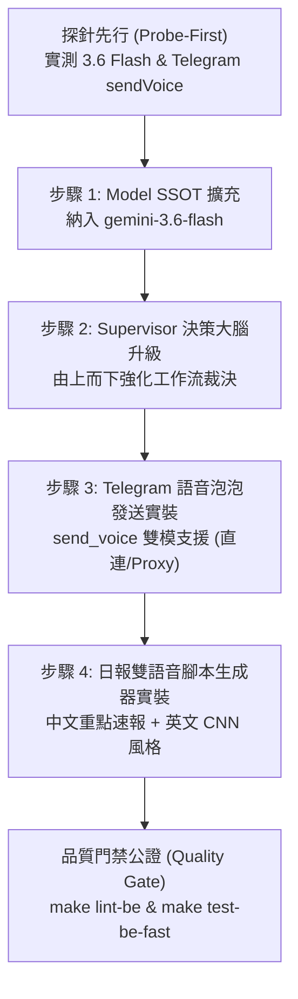

# Phase 5.12.2: 決策大腦 Gemini 3.6 Flash 升級與 Telegram 雙語音泡泡速報 (Decision Brain 3.6 Flash Upgrade & Telegram Dual-Voice Briefings)

## 📌 背景與動機 (Context & Motivation)

在 Phase 5.12.1 完成了星環拓樸優化、音檔 Storage TTL 定期清理與潛客破冰流程後，系統在 Google AI Studio 遙測數據顯示出高度健康的穩定度（`gemini-3.1-flash-lite` 消耗 114 RPD、`gemini-3.5-flash-lite` 消耗 29 RPD、TTS 消耗 7 RPD）。

然而，經過深度對帳與實體代碼審計，目前在「管理者由上而下的戰略決策」與「行動端語音體驗」上存在以下兩大真實斷層：

1. **核心工作流 Supervisor 決策智力受限 (Supervisor Decision Intelligence Bottleneck)**：
   - 歷史日誌顯示，過去日報討論偶發「職責混淆（Alice 與 Bob 職責倒置）」與「泛泛空談」，根源在於負責裁決與統籌的多 Agent 大腦（`SupervisorNode`）使用的是 Lite 系列模型（3.5 Flash-Lite）。
   - **實體資源事實**：Google AI Studio 現已開放 **`Gemini 3.6 Flash`** 免費額度（20 RPD、5 RPM、250K TPM），目前使用率為 **0 / 20**（完全閒置）。
   - 每天 20 次的額度無法跑巨型高頻爬蟲，但**極度適合分配給全系統調用頻率最低（1~2 次/天）、權力最高、最需要宏觀長文本邏輯裁決的決策中樞**。

2. **Telegram 語音傳輸降級為純文字連結 (Voice Experience Gap)**：
   - 目前 [report_enrichment_service.py](file:///Users/vincenta/GoogleKwok022/Archon/python/src/server/services/report_enrichment_service.py) 產出音訊後，僅將音檔上傳至 Supabase Storage，並在 Telegram 發送 Markdown 文字連結 `[Audio Link](https://...)`。
   - 使用者在 Telegram 手機端無法直接按下播放，必須額外跳轉瀏覽器下載。
   - 過去受限於 Hugging Face 官方防火牆攔截 `api.telegram.org` 封包（Phase 5.11.20 教訓），導致後端無法直接傳送檔案。現今系統已打通 Vercel Proxy 與直連雙通道，且 TTS 每日配額為 10 次，完全足以支撐將日報升級為「**可直接點擊收聽的 Telegram 原生語音泡泡 (Voice Message)**」。

---

## 🎯 核心實作目標 (Objectives)

遵循「**不搞虛假開發、零猜測、防改 A 壞 B、恪守 SSOT 與 DRY**」鐵律，本階段聚焦兩大目標：

1. **決策大腦精準升級 (3.6 Flash)**：
   - 在 `model_ssot.py` 納入 `SUPERVISOR_MODEL` (`models/gemini-3.6-flash`)。
   - 將工作流最高決策節點 `SupervisorNode` 由 3.5 升級為 3.6 Flash，嚴格限制在日報決策與複雜工作流裁決調用，每日消耗不超過 5~10 次。

2. **Telegram 雙軌語音泡泡速報與重大緊急告警 (Dual-Voice Briefings & Critical Voice Alerts)**：
   - **日常雙軌日報 (每日 2 次)**：日報定時產出時，自動透過 TTS 產出**兩顆獨立語音泡泡**推送至 Telegram：
     - 🎙️ **中文版（執行長重點速報）**：講重點、不念流水帳，聚焦當日合格潛客痛點與跟進指示（時長約 45 秒）。
     - 🎙️ **英文版（CNN 商業新聞風格）**：專業美式財經主播風格（CNN Anchor Tone），提供精煉的 60 秒國際商業速報。
   - **重大緊急事件語音速報 (Critical Emergency Voice Alerts，每日上限預留 3 次)**：
     - 🚨 **熔斷與核心故障告警**：當工作流觸發 Circuit Breaker 熔斷、Sentinel 發現預算嚴重超標或節點嚴重崩潰時，除文字推播外，**即時生成並發送緊急語音泡泡**，讓負責人第一時間用聽的就能掌握系統重大異常。
     - 🎯 **每日 TTS 配額完美分配**：日常雙軌日報 2 次 + 緊急/重大事件預留 3 次 = **每日最高 5 次**，精準鎖定在 10 RPD 的 50% 安全邊界內，既滿足日常速報，又具備緊急防護能力！

---

## 🛠️ 循序漸進實作步驟 (Step-by-Step Implementation)



---

### 步驟 1：Model SSOT 擴充與價格/配置對齊 (SSOT & DRY)

* **修改檔案**：
  1. `python/src/server/config/model_ssot.py`：
     - 在 `SYSTEM_MODELS` 新增：
       ```python
       "SUPERVISOR_MODEL": "models/gemini-3.6-flash",
       ```
     - 確保 `get_target_models()` 與 Fallback 機制同步支援 `SUPERVISOR_MODEL`（當 3.6 異常時安全降階至 3.5 或 Lite）。
  2. `python/src/server/config/config.py`：
     - 補齊 `gemini-3.6-flash` 之 Token 定價字典（避免 `TokenUsageService` 找不到費率報警）。

---

### 步驟 2：工作流 Supervisor 決策升級 (Top-Down Governance)

* **修改檔案**：
  1. `python/src/agents/workflow/nodes.py`：
     - 在 [`SupervisorNode.run()`](file:///Users/vincenta/GoogleKwok022/Archon/python/src/agents/workflow/nodes.py#L32) 中：
       ```python
       model_name = os.getenv("SUPERVISOR_AGENT_MODEL")
       if not model_name:
           from src.server.config.model_ssot import SYSTEM_MODELS
           model_name = SYSTEM_MODELS.get("SUPERVISOR_MODEL", SYSTEM_MODELS["DEFAULT_PRO"]).replace("models/", "")
       ```
     - 讓 Supervisor 擁有最強的 3.6 Flash 推理能力，精準解析對話歷史與痛點指標，杜絕角色顛倒。
  2. `python/src/server/api_routes/internal_api.py`：
     - 保持 API 契約同步，將 `SUPERVISOR_AGENT_MODEL` 對齊 SSOT。

---

### 步驟 3：Telegram 服務層語音泡泡實裝 (`send_voice`)

* **修改檔案**：
  1. `python/src/server/services/system/telegram_service.py`：
     - 新增非同步方法：
       ```python
       async def send_voice(
           self,
           voice_bytes: bytes,
           caption: str | None = None,
           filename: str = "briefing.ogg",
           parse_mode: str = "Markdown"
       ) -> bool:
       ```
     - **直連模式**：調用 `https://api.telegram.org/bot{token}/sendVoice`，以 `multipart/form-data` 傳遞 `voice` 檔案與 `caption`。
     - **防壞防線 (Fallback)**：若因網路或格式引發異常，記錄錯誤並自動降級呼叫 `send_message` 發送純文字備援，絕不丟棄通知。
  2. `enduser-ui-fe/api/telegram.js`（Proxy 端）：
     - 擴充 Vercel Proxy，支援轉發 `sendVoice` 請求（接收 Base64 或二進位 Payload 轉發 Telegram）。

---

### 步驟 4：日報雙語音速報與重大緊急告警管線實裝 (Dual-Voice & Emergency Pipeline)

* **修改檔案**：
  1. `python/src/server/prompts/pm_prompts.py`：
     - 新增三個專用高質量腳本 Prompt：
       - `DAILY_VOICE_BRIEF_ZH`: 中文重點速報提示詞（限定 150~200 字，包含開場、業務重點潛客痛點、行銷進展、行動指示）。
       - `DAILY_VOICE_BRIEF_EN`: 英文 CNN 新聞主播提示詞（限定 100~130 字，權威節奏，美式商業新聞語調）。
       - `EMERGENCY_VOICE_ALERT`: 重大緊急事件警報語音提示詞（限定 60~80 字，簡短、冷靜、明確指出異常模組與緊急行動方針）。
  2. `python/src/server/services/report_enrichment_service.py`：
     - 重構 `attach_podcast_audio` 為雙軌流程：
       - 軌道一：呼叫 `SUPERVISOR_MODEL` 生成中文重點速報腳本 $\to$ TTS 生成中文語音 $\to$ `telegram_service.send_voice(zh_bytes, caption="🎙️ 【星環商業晨會】執行長重點速報")`。
       - 間隔 5 秒（防範 3 RPM 限流）。
       - 軌道二：呼叫 `SUPERVISOR_MODEL` 生成英文 CNN 腳本 $\to$ TTS 生成英文語音（指定 voice_name="Fenrir"） $\to$ `telegram_service.send_voice(en_bytes, caption="🎙️ 【CNN Business Flash】60-Second Executive Brief")`。
       - 上傳 Storage 保底，維護 14 天 TTL。
  3. `python/src/server/services/system/alert_voice_service.py`（新增專用服務或整合至 TelegramService）：
     - 當觸發 Circuit Breaker 熔斷或 Sentinel CRITICAL 告警時，調用 `trigger_emergency_voice_alert(incident_text: str)`，生成並直推緊急語音泡泡至 Telegram：`🚨 【緊急系統告警】請立即查閱異常狀態`。

---

## 🛡️ 邊界防禦與歷史教訓對齊 (Defensive Checks)

1. **防 429 死亡循環**：
   - 3.6 Flash 僅供 Supervisor 決策與日報腳本生成（單日 $\le 5$ 次，佔配額 25%）。底層 MarketBot / DevBot 維持 3.1 Lite。
   - TTS 配額分配：日常雙軌日報固定 2 次 + 緊急事件上限 3 次 = 每日上限 5 次，佔用 10 RPD 中的 50%，永遠保有 5 次安全邊界。
   - 中英文兩次 TTS 發送之間強制 sleep 5.0 秒，杜絕 3 RPM 衝突。
2. **防改 A 壞 B (Zero Regression)**：
   - Telegram 語音泡泡失敗時，自動降級為原本的 Storage 網址連結文字訊息。
   - 本地開發環境維持直連模式，部署環境維持 Proxy 模式。
3. **零虛假驗證 (Physical Verification Gate)**：
   - 執行 `make lint-be`（Ruff + MyPy 393 檔案 0 錯誤）。
   - 執行 `make test-be-fast`（確保既有 811 個單元測試 100% 通過）。
   - 新增真實單元測試 `test_telegram_send_voice.py` 與 `test_dual_voice_pipeline.py`。
